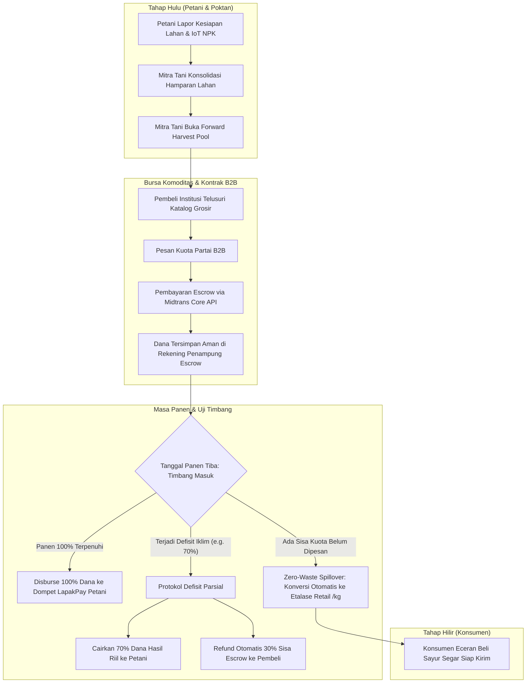

<div align="center">

# 🌱 LAPAKTANI (Lapak Tani)
### Platform Agribisnis Terpadu Hulu-ke-Hilir: Bursa Komoditas Pra-Panen, Penyerapan Zero-Waste, dan Sistem Multi-Role Adaptif

[](https://flutter.dev)
[](https://nodejs.org)
[-4479A1?style=for-the-badge&logo=mysql&logoColor=white)](https://www.mysql.com)
[](https://midtrans.com)
[](#-arsitektur-dan-diagram-alur-transaksi)
[](https://pens.ac.id)
[](LICENSE)

<br/>

<a href="https://github.com/ZenixSoftware/LapakTani">
  
</a>

<p align="center">
  <b>LapakTani</b> adalah platform ekosistem agribisnis modern yang mendemokratisasi rantai pasok pertanian Indonesia. Menghubungkan petani gurem, kelompok tani (Poktan / Mitra Tani), penyuluh pertanian lapangan (PPL), hingga pembeli institusi (B2B Horeka / Dapur Makan Bergizi Gratis) dan konsumen akhir dalam satu arsitektur terpadu.
</p>

---

</div>

## 📌 Daftar Isi
1. [Latar Belakang & Inovasi Sistem](#-latar-belakang--inovasi-sistem-why-lapaktani)
2. [Matriks 4 Role Adaptif (Role-Based App Shell)](#-matriks-4-role-adaptif-role-based-app-shell)
3. [Arsitektur & Diagram Alur Transaksi](#-arsitektur-dan-diagram-alur-transaksi)
4. [Universal Request Logger Middleware](#-universal-request-logger--tracing-middleware)
5. [Panduan Cepat Kolaborator (Quick Start)](#-panduan-cepat-menjalankan-sistem-collaborator-quick-start)
6. [Kredensial Akun Demo Resmi](#-kredensial-akun-demo-resmi-siap-pakai)
7. [Struktur Direktori Monorepo](#-struktur-direktori-monorepo)

---

## 💡 Latar Belakang & Inovasi Sistem (Why LapakTani?)

Rantai pasok pertanian tradisional kerap merugikan petani akibat fluktuasi harga tengkulak, kepastian serapan yang rendah, serta tingginya angka *food loss* pasca-panen. E-commerce retail biasa tidak mampu mengakomodasi sifat komoditas pertanian yang memiliki masa tunggu panen, risiko cuaca, dan kebutuhan pembelian skala tonase.

### Komparasi Model Bisnis
| Aspek | E-Commerce Retail Konvensional | Platform Agribisnis LapakTani |
|---|---|---|
| **Waktu Penjualan** | Hanya barang *ready-stock* di gudang | Kontrak forward pra-panen (*Forward Pool*) + Etalase Retail |
| **Pihak Penjual** | Toko individual / *reseller* | Kelompok Tani teragregasi (*Mitra Tani*) & Petani Anggota |
| **Pembeli Sasaran** | Konsumen akhir eceran (/kg) | Dual-Market: Eceran Rumah Tangga + B2B Partai Besar (Horeka, MBG) |
| **Mitigasi Gagal Panen** | Pembatalan sepihak / sanksi toko | **Protokol Defisit Parsial**: Pencairan riil + Pengembalian dana sisa instan |
| **Sisa Kuota Tidak Terserap** | Terbuang busuk (*food loss*) | **Mekanisme Zero-Waste Spillover**: Otomatis dialihkan ke eceran pasar |
| **Transparansi Kualitas** | Foto etalase statis | **IoT Soil Telemetry** (NPK, pH, kelembaban lahan) & Audit Mutu PPL |

### 4 Pilar Inovasi Utama
1. **Bottom-Up Harvest Aggregation**: Konsolidasi lahan mikro petani gurem (rata-rata 0.5–2 Ha) dihimpun oleh Mitra Tani menjadi hamparan terpadu (11.10+ Ha) untuk memenuhi syarat volume industri.
2. **Bursa Partai & Forward Pool (B2B)**: Pembeli institusi dapat mengamankan kuota komoditas unggulan (Cabai Kencana, Tomat Beef, Kentang Dieng) sejak masa vegetatif dengan kepastian harga kontrak.
3. **Protokol Mitigasi Defisit (Atomic Escrow Settlement)**: Bila anomali iklim menyebabkan panen hanya mencapai 70% dari target kontrak, sistem secara otomatis mencairkan dana senilai hasil panen riil ke dompet petani dan seketika mengembalikan sisa escrow ke pembeli tanpa membatalkan transaksi.
4. **Zero-Waste Spillover**: Kuota partai yang belum terserap saat tanggal panen tiba dapat dialihkan ke etalase eceran per kilogram dalam satu klik, mencegah komoditas busuk di gudang.

---

## 👥 Matriks 4 Role Adaptif (Role-Based App Shell)

Aplikasi mobile LapakTani mengadopsi arsitektur cangkang aplikasi dinamis (*Dynamic Role-Based App Shell*). Tampilan, navigasi bawah, dan kapabilitas sistem beradaptasi otomatis mengikuti profil pengguna yang masuk:

| Peran Pengguna | Persona Contoh | Lingkup Hak Akses & Fitur Khusus |
|---|---|---|
| 🛒 **Pembeli Retail & Grosir** | *Budi Pembeli* | • **Tab Beranda**: Katalog sayur & buah segar eceran (/kg).<br/>• **Tab Grosir**: Bursa Partai forward pool borongan (/kuintal).<br/>• **Checkout & Escrow**: Pembayaran Virtual Account / QRIS via Midtrans Core API.<br/>• **Live Tracking**: Pelacakan kurir logistik dan konfirmasi penerimaan (eksklusif pembeli). |
| 👨‍🌾 **Petani Anggota** | *Pak Supardi* | • **Antarmuka Minimalis**: Tipografi jelas dan ramah petani lapangan.<br/>• **Tugas Alokasi Tanam**: Status penugasan kuota komoditas dari Poktan.<br/>• **Telemetri Lahan IoT**: Monitoring real-time sensor tanah NPK 8-in-1, pH, dan kelembaban.<br/>• **Lapor Hama**: Pelaporan foto dan gejala serangan OPT ke penyuluh desa. |
| 🏢 **Mitra Tani / Poktan** | *Made Irawan* | • **Tab Pesanan**: Manajemen order eceran pelanggan (Perlu Dipetik, Siap Kirim).<br/>• **Tab Etalase Toko**: Saklar buka-tutup toko, manajemen stok eceran, dan aksi *Spillover* partai ke eceran.<br/>• **Tab Lahan & Pool**: Konsolidasi 11.10 Ha lahan anggota, pembukaan bursa partai, dan timbang panen masuk.<br/>• **LapakPay**: Dompet digital pencairan hasil lelang panen B2B dan eceran. |
| 🎓 **Penyuluh Pertanian (PPL)** | *Ahmad Penyuluh, S.P.* | • **Lencana Resmi**: Verifikasi instansi BPP Dinas Pertanian.<br/>• **Edukasi Budidaya**: Pembuatan artikel dan SOP agronomi bertahap (US-18).<br/>• **Early Warning Hama**: Validasi laporan OPT petani desa dan rekomendasi penanganan darurat (US-19). |

---

## 📐 Arsitektur dan Diagram Alur Transaksi



---

## ⚡ Universal Request Logger & Tracing Middleware

Backend LapakTani dilengkapi middleware observabilitas universal yang terpasang di level aplikasi (`server.js`) dan mencegat **100% rute API**:

* **Distributed Tracing**: Menghasilkan pengenal acak atau membaca header `X-Request-Id` untuk pelacakan *end-to-end* antara aplikasi Flutter dan backend.
* **Presisi Waktu Tinggi**: Mengukur latensi eksekusi dengan `process.hrtime.bigint()` beresolusi nanodetik (dikonversi ke milidetik).
* **Indikator Visual Terminal**: Menampilkan kode status HTTP berwarna ANSI (2xx Hijau, 3xx Cyan, 4xx Kuning, 5xx Merah).
* **Contoh Jejak Log**:
  ```text
  [REQ c45fdf17] --> GET /api/b2b-contracts/pools from 127.0.0.1 [2026-11-09T20:46:53.827Z]
  [RES c45fdf17] <-- GET /api/b2b-contracts/pools 200 (6.03 ms)
  ```

---

## 🚀 Panduan Cepat Menjalankan Sistem (Collaborator Quick Start)

### 1. Prasyarat Sistem
* **Node.js**: v18.x atau lebih baru (Disarankan v20 LTS / v24).
* **MySQL / MariaDB**: Server database lokal (via XAMPP, Laragon, Docker, atau MySQL Community).
* **Flutter SDK**: v3.22.x atau lebih baru.

---

### 2. Setup Backend & Database (1-Click Import)

```bash
# 1. Masuk ke direktori backend
cd lapaktani_backend

# 2. Pasang dependensi
npm install

# 3. Import Database Konsolidasi (28 Tabel Siap Pakai)
# Buka phpMyAdmin (http://localhost/phpmyadmin), buat database 'lapaktani_db',
# lalu import file: lapaktani_backend/database/lapaktani_complete_latest.sql
# ATAU import langsung via terminal:
mysql -u root -p lapaktani_db < database/lapaktani_complete_latest.sql

# 4. Buat file konfigurasi .env
cp .env.example .env
# Sesuaikan MIDTRANS_SERVER_KEY, DB_HOST, DB_USER, dan JWT_SECRET

# 5. Jalankan server pengembangan
npm run dev
```
*Backend akan aktif di `http://localhost:3000` dengan endpoint health check di `http://localhost:3000/api/health`.*

---

### 3. Setup Mobile Flutter (Bebas Konflik API Base URL)

Aplikasi Flutter telah dilengkapi sistem konfigurasi dinamis via `--dart-define` sehingga **tidak perlu mengubah kode sumber `api_service.dart`**:

```bash
# Masuk ke direktori aplikasi mobile
cd lapaktani_app

# Pasang dependensi Flutter
flutter pub get

# PILIHAN A: Pengujian Device Fisik / Cloud Ngrok (Default)
flutter run

# PILIHAN B: Pengujian Kolaborator Lokal (XAMPP / Localhost PC / Web / Desktop)
flutter run --dart-define=API_BASE_URL=http://localhost:3000/api

# PILIHAN C: Pengujian Android Emulator Resmi Google (Koneksi ke Host Localhost)
flutter run --dart-define=API_BASE_URL=http://10.0.2.2:3000/api
```

---

## 🔑 Kredensial Akun Demo Resmi (Siap Pakai)

Semua akun pengujian di bawah ini telah terdaftar di database `lapaktani_complete_latest.sql` dengan password standar yang sama:

> **Kata Sandi Default**: `password123`

| Peran Sistem | Nama Pengguna | Alamat Email | Entitas Terdaftar |
|---|---|---|---|
| **Ketua Poktan (Mitra Tani)** | Made Irawan | `made@poktan.lapaktani.id` | Poktan Tani Makmur (Lembang) |
| **Petani Anggota** | Pak Supardi | `supardi@petani.lapaktani.id` | Anggota Blok Utara Cabai Kencana |
| **Penyuluh Pertanian (PPL)** | Ahmad Penyuluh, S.P. | `penyuluh@lapaktani.id` | Balai Penyuluhan Pertanian (BPP) Lembang |
| **Pembeli Institusi (B2B)** | Budi Pembeli | `pembeli@lapaktani.id` | CV Segar Mandiri Catering & Resto |
| **Administrator Platform** | Admin LapakTani | `admin@lapaktani.id` | LapakTani HQ Operations |

---

## 📂 Struktur Direktori Monorepo

```
PROYEK-LAPAKTANI/
├── README.md                              # Dokumentasi showcase utama proyek
├── lapaktani_app/                         # Client Frontend Flutter (Android, iOS, Web)
│   ├── lib/
│   │   ├── core/                          # Services (ApiService), Theme, Routing & Config
│   │   │   └── config/app_config.dart     # Dynamic API Base URL resolver (--dart-define)
│   │   ├── features/
│   │   │   ├── auth/                      # Otentikasi & Model Pengguna
│   │   │   ├── buyer/screens/             # WholesaleDetailScreen (Bursa Partai B2B)
│   │   │   ├── community/                 # Edukasi Pertanian & Lapor Hama PPL
│   │   │   ├── home/                      # Beranda Katalog Eceran & Grosir B2B
│   │   │   ├── navigation/                # RoleBasedAppShell (Cangkang 4 Peran Dinamis)
│   │   │   ├── order/                     # Checkout & PaymentInstructionScreen (Midtrans)
│   │   │   ├── penyuluh/                  # Hub PPL Lencana Resmi
│   │   │   ├── petani/                    # Dashboard Petani Sederhana & Tugas Kuota
│   │   │   ├── poktan/                    # MitraStoreCatalogScreen & PoktanMainShell
│   │   │   └── store/                     # StoreProfileScreen (Etalase Profil Mitra Tani)
│   │   └── main.dart                      # Inisialisasi Aplikasi Mobile
│   └── pubspec.yaml                       # Dependensi Flutter
│
└── lapaktani_backend/                     # REST API Monolith (Express.js & MySQL)
    ├── database/
    │   └── lapaktani_complete_latest.sql  # Dump SQL 28 tabel & seed akun resmi
    ├── src/
    │   ├── config/                        # Pool MySQL (mysql2/promise) & Redis Cache
    │   ├── controllers/                   # Logika Bisnis: Order, B2B Pool, Pembayaran, Hama
    │   ├── middlewares/                   # authMiddleware & requestLogger.js (Universal)
    │   └── routes/                        # Router Endpoint API Modular
    ├── server.js                          # Server Entry Point & Global Middlewares
    └── package.json                       # Dependensi Node.js
```

---

<div align="center">

**LapakTani** dikembangkan dengan dedikasi untuk memajukan kedaulatan pangan dan kesejahteraan petani Indonesia.  
*Workshop Pemrograman Framework — Politeknik Elektronika Negeri Surabaya (PENS) Kampus Sumenep.*

</div>
