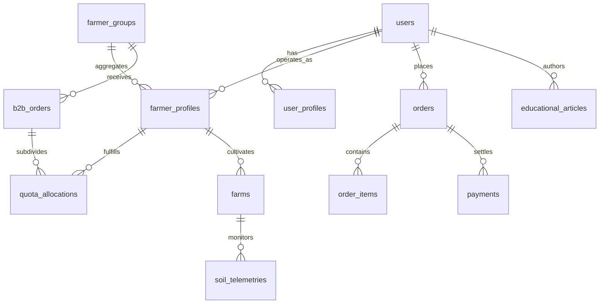

# Minimum Viable Product (MVP) System Inventory

**Project**: LapakTani  
**Repository Branch**: `valo-Branch`  
**Architecture**: Monolithic Node.js REST API + MySQL Engine + Flutter Cross-Platform Client  
**Execution Context**: Academic & Technical Evaluation Document  

---

## 1. REST API Routing & Controller Capabilities

The backend application entrypoint ([`server.js`](file:///c:/Users/dava1/Documents/KULIAH/TUGAS%20KULIAH%20SEMESTER%203/WORKSHOP%20PEMROGRAMAN%20FRAMEWORK/PROYEK-LAPAKTANI/lapaktani_backend/server.js)) exposes 12 domain route prefixes mounted on `/api`:

| Route Prefix | Controller / Handler | Key Endpoints | Business Capability Summary |
| :--- | :--- | :--- | :--- |
| **`/api/auth`** | [`authController.js`](file:///c:/Users/dava1/Documents/KULIAH/TUGAS%20KULIAH%20SEMESTER%203/WORKSHOP%20PEMROGRAMAN%20FRAMEWORK/PROYEK-LAPAKTANI/lapaktani_backend/src/controllers/authController.js) | `POST /register` `POST /login` | Manages user identity, password hashing (bcrypt), and JSON Web Token (JWT) issuance. |
| **`/api/products`** | [`productController.js`](file:///c:/Users/dava1/Documents/KULIAH/TUGAS%20KULIAH%20SEMESTER%203/WORKSHOP%20PEMROGRAMAN%20FRAMEWORK/PROYEK-LAPAKTANI/lapaktani_backend/src/controllers/productController.js) | `GET /` `GET /:id` `POST /` `PUT /:id` `DELETE /:id` | Manages agricultural product catalogs, grading criteria, harvest schedules, and stock availability. |
| **`/api/profiles`** | [`profileController.js`](file:///c:/Users/dava1/Documents/KULIAH/TUGAS%20KULIAH%20SEMESTER%203/WORKSHOP%20PEMROGRAMAN%20FRAMEWORK/PROYEK-LAPAKTANI/lapaktani_backend/src/controllers/profileController.js) | `GET /me` `PUT /me` `POST /farmer` | Handles user profile biodata, farmer KYC verification statuses, and land/farm details. |
| **`/api/penyuluh`** | [`penyuluhController.js`](file:///c:/Users/dava1/Documents/KULIAH/TUGAS%20KULIAH%20SEMESTER%203/WORKSHOP%20PEMROGRAMAN%20FRAMEWORK/PROYEK-LAPAKTANI/lapaktani_backend/src/controllers/penyuluhController.js) | `GET /dashboard` `POST /verify-farmer` | Empowers agricultural extension officers (PPL) to inspect, review, and verify farmer land credentials. |
| **`/api/master`** | [`masterDataController.js`](file:///c:/Users/dava1/Documents/KULIAH/TUGAS%20KULIAH%20SEMESTER%203/WORKSHOP%20PEMROGRAMAN%20FRAMEWORK/PROYEK-LAPAKTANI/lapaktani_backend/src/controllers/masterDataController.js) | `GET /provinces` `GET /regencies/:id` `GET /districts/:id` `GET /villages/:id` `GET /commodities` | Serves standardized administrative regional reference data and national commodity hierarchies. |
| **`/api/upload`** | [`uploadController.js`](file:///c:/Users/dava1/Documents/KULIAH/TUGAS%20KULIAH%20SEMESTER%203/WORKSHOP%20PEMROGRAMAN%20FRAMEWORK/PROYEK-LAPAKTANI/lapaktani_backend/src/controllers/uploadController.js) | `POST /product-image` | Handles multi-part media uploads with file magic byte inspection and sanitized disk storage. |
| **`/api/education`** | [`educationController.js`](file:///c:/Users/dava1/Documents/KULIAH/TUGAS%20KULIAH%20SEMESTER%203/WORKSHOP%20PEMROGRAMAN%20FRAMEWORK/PROYEK-LAPAKTANI/lapaktani_backend/src/controllers/educationController.js) | `GET /articles` `GET /articles/:id` `POST /articles` | Powers official agricultural guide publishing with dynamic PPL accreditation badges. |
| **`/api/cart`** | [`cartController.js`](file:///c:/Users/dava1/Documents/KULIAH/TUGAS%20KULIAH%20SEMESTER%203/WORKSHOP%20PEMROGRAMAN%20FRAMEWORK/PROYEK-LAPAKTANI/lapaktani_backend/src/controllers/cartController.js) | `GET /` `POST /items` `PUT /items/:id` `DELETE /items/:id` | Handles user basket states, commodity quantity modifications, and pre-checkout item reservations. |
| **`/api/orders`** | [`orderController.js`](file:///c:/Users/dava1/Documents/KULIAH/TUGAS%20KULIAH%20SEMESTER%203/WORKSHOP%20PEMROGRAMAN%20FRAMEWORK/PROYEK-LAPAKTANI/lapaktani_backend/src/controllers/orderController.js) | `POST /checkout` `GET /my-orders` `GET /farmer/orders` `PUT /:id/status` `POST /webhook` | Coordinates end-to-end purchasing lifecycle, escrow payment status triggers, and fulfillment tracking. |
| **`/api/soil`** | [`productController.js`](file:///c:/Users/dava1/Documents/KULIAH/TUGAS%20KULIAH%20SEMESTER%203/WORKSHOP%20PEMROGRAMAN%20FRAMEWORK/PROYEK-LAPAKTANI/lapaktani_backend/src/controllers/productController.js) | `GET /telemetry/:productId` | Delivers precision agricultural IoT telemetry data including soil pH, N-P-K, and moisture levels. |
| **`/api/payments`** | [`paymentController.js`](file:///c:/Users/dava1/Documents/KULIAH/TUGAS%20KULIAH%20SEMESTER%203/WORKSHOP%20PEMROGRAMAN%20FRAMEWORK/PROYEK-LAPAKTANI/lapaktani_backend/src/controllers/paymentController.js) | `POST /charge` `GET /status/:orderId` `POST /midtrans-callback` | Orchestrates Midtrans Core API charges, bank virtual account issuance, and idempotent webhook callbacks. |
| **`/api/poktan`** | [`poktanController.js`](file:///c:/Users/dava1/Documents/KULIAH/TUGAS%20KULIAH%20SEMESTER%203/WORKSHOP%20PEMROGRAMAN%20FRAMEWORK/PROYEK-LAPAKTANI/lapaktani_backend/src/controllers/poktanController.js) | `GET /info` `GET /members` `POST /b2b-orders` `GET /b2b-orders` `POST /allocate-quota` `GET /my-tasks` | Manages farmer group consolidation, cumulative land area aggregation, and B2B contract quota allocation. |

---

## 2. Relational Database Schema & Entities

The persistent storage is powered by MySQL 8.4 (`lapaktani_db`) configured through structured migration scripts under [`lapaktani_backend/migrations/`](file:///c:/Users/dava1/Documents/KULIAH/TUGAS%20KULIAH%20SEMESTER%203/WORKSHOP%20PEMROGRAMAN%20FRAMEWORK/PROYEK-LAPAKTANI/lapaktani_backend/migrations):

### Physical Tables Inventory:

1. **Identity & Access Management**:
   - `users`: Core account credentials, email, password hash, role classification (`petani`, `pembeli`, `penyuluh`, `admin`).
   - `user_roles`: Master dictionary defining system security roles.
   - `user_profiles`: Demographic data, national identity numbers (NIK), civil addresses, PPL accreditation (`bpp_unit`, `nip`), and verification statuses.
   - `farmer_profiles`: Extension attributes for verified farmers linked to designated farmer groups (`farmer_groups`).

2. **Master & Administrative Geospatial Data**:
   - `provinces`, `regencies`, `districts`, `villages`: Hierarchical Indonesian administrative territory lookup tables.
   - `commodity_categories`, `commodities`, `commodity_units`: Agricultural classification models.

3. **Product Catalog & Agronomy IoT**:
   - `products`: Product listings with commodity links, prices, units, and available inventory.
   - `product_images`: Multi-asset image galleries per product.
   - `product_grades`: Quality grading classifications (Grade A, B, Export Standard).
   - `farms`: Cultivation land properties including polygon boundary coordinates and total area in hectares (`land_area_ha`).
   - `soil_telemetries`: Real-time precision agricultural metrics (pH, Nitrogen, Phosphorus, Potassium, moisture percentage, fertility index).

4. **Commerce, Cart & Escrow Orders**:
   - `shopping_carts` & `cart_items`: Active shopping baskets and reserved item records.
   - `orders`: Transactional header capturing order status (`WAITING_PAYMENT`, `PROCESSING`, `NEED_HARVEST`, `SHIPPED`, `IN_TRANSIT`, `DELIVERED`, `COMPLETED`, `CANCELLED`), delivery fees, and shipping destinations.
   - `order_items`: Line-item breakdown of crop products, unit purchase prices, and ordered weights.
   - `payments`: Payment gateway transaction logs, Midtrans reference keys, payment types (Bank Transfer / VA, QRIS, GoPay), and settlement timestamps.

5. **Farmer Group (Poktan) & B2B Institutional Contracts**:
   - `farmer_groups`: Registered institutional farmer collectives (Kelompok Tani / Gapoktan) headed by an elected `chairman_user_id`.
   - `b2b_contracts`: Legal corporate procurement frameworks between agribusiness buyers and farmer groups.
   - `b2b_orders`: Institutional bulk commodity demands requiring collective supply fulfillment.
   - `quota_allocations`: Dynamic allocation mapping target kilogram quotas and harvest deadlines from B2B orders to individual member farmers.
   - `notifications`: Push and in-app event log alerting farmers to newly allocated harvest tasks and order updates.

6. **Extension & Agronomy Knowledge (US-18)**:
   - `educational_articles`: Persistent repository of agronomic guides containing title, commodity category, structured step-by-step procedures (`steps_json`), cover images, read duration, and verified PPL author bindings.

---

## 3. Mobile Client Architectural Screen Inventory

The Flutter client ([`lapaktani_app`](file:///c:/Users/dava1/Documents/KULIAH/TUGAS%20KULIAH%20SEMESTER%203/WORKSHOP%20PEMROGRAMAN%20FRAMEWORK/PROYEK-LAPAKTANI/lapaktani_app)) is organized into feature modules under `lib/features/`:

| Module | Screen Class / Path | Primary User Role | Functional Responsibility |
| :--- | :--- | :--- | :--- |
| **Authentication & Onboarding** | [`splash_screen.dart`](file:///c:/Users/dava1/Documents/KULIAH/TUGAS%20KULIAH%20SEMESTER%203/WORKSHOP%20PEMROGRAMAN%20FRAMEWORK/PROYEK-LAPAKTANI/lapaktani_app/lib/features/onboarding/splash_screen.dart) [`onboarding_screen.dart`](file:///c:/Users/dava1/Documents/KULIAH/TUGAS%20KULIAH%20SEMESTER%203/WORKSHOP%20PEMROGRAMAN%20FRAMEWORK/PROYEK-LAPAKTANI/lapaktani_app/lib/features/onboarding/onboarding_screen.dart) [`login_screen.dart`](file:///c:/Users/dava1/Documents/KULIAH/TUGAS%20KULIAH%20SEMESTER%203/WORKSHOP%20PEMROGRAMAN%20FRAMEWORK/PROYEK-LAPAKTANI/lapaktani_app/lib/features/auth/login_screen.dart) [`register_screen.dart`](file:///c:/Users/dava1/Documents/KULIAH/TUGAS%20KULIAH%20SEMESTER%203/WORKSHOP%20PEMROGRAMAN%20FRAMEWORK/PROYEK-LAPAKTANI/lapaktani_app/lib/features/auth/register_screen.dart) | Guest | Initial application bootstrap, JWT session checks, role onboarding, and credential validation. |
| **Home & Discovery** | [`home_dashboard_screen.dart`](file:///c:/Users/dava1/Documents/KULIAH/TUGAS%20KULIAH%20SEMESTER%203/WORKSHOP%20PEMROGRAMAN%20FRAMEWORK/PROYEK-LAPAKTANI/lapaktani_app/lib/features/home/home_dashboard_screen.dart) [`search_screen.dart`](file:///c:/Users/dava1/Documents/KULIAH/TUGAS%20KULIAH%20SEMESTER%203/WORKSHOP%20PEMROGRAMAN%20FRAMEWORK/PROYEK-LAPAKTANI/lapaktani_app/lib/features/home/search_screen.dart) | Buyer / Farmer | Primary marketplace dashboard displaying featured harvests, category navigation, Poktan banners, and keyword search. |
| **Product & Telemetry** | [`product_detail_screen.dart`](file:///c:/Users/dava1/Documents/KULIAH/TUGAS%20KULIAH%20SEMESTER%203/WORKSHOP%20PEMROGRAMAN%20FRAMEWORK/PROYEK-LAPAKTANI/lapaktani_app/lib/features/product/product_detail_screen.dart) [`add_product_screen.dart`](file:///c:/Users/dava1/Documents/KULIAH/TUGAS%20KULIAH%20SEMESTER%203/WORKSHOP%20PEMROGRAMAN%20FRAMEWORK/PROYEK-LAPAKTANI/lapaktani_app/lib/features/product/add_product_screen.dart) [`edit_product_screen.dart`](file:///c:/Users/dava1/Documents/KULIAH/TUGAS%20KULIAH%20SEMESTER%203/WORKSHOP%20PEMROGRAMAN%20FRAMEWORK/PROYEK-LAPAKTANI/lapaktani_app/lib/features/product/edit_product_screen.dart) | Buyer / Farmer | Detailed crop view with Smart Agri Telemetry cards (pH, NPK, moisture), farmer profiling, and product listing forms. |
| **Cart & Procurement** | [`cart_screen.dart`](file:///c:/Users/dava1/Documents/KULIAH/TUGAS%20KULIAH%20SEMESTER%203/WORKSHOP%20PEMROGRAMAN%20FRAMEWORK/PROYEK-LAPAKTANI/lapaktani_app/lib/features/cart/cart_screen.dart) | Buyer | Itemized basket view with real-time subtotal calculation, quantity steppers, and pre-checkout item selection. |
| **Checkout & Midtrans Settlement** | [`checkout_screen.dart`](file:///c:/Users/dava1/Documents/KULIAH/TUGAS%20KULIAH%20SEMESTER%203/WORKSHOP%20PEMROGRAMAN%20FRAMEWORK/PROYEK-LAPAKTANI/lapaktani_app/lib/features/order/checkout_screen.dart) [`payment_method_selection_screen.dart`](file:///c:/Users/dava1/Documents/KULIAH/TUGAS%20KULIAH%20SEMESTER%203/WORKSHOP%20PEMROGRAMAN%20FRAMEWORK/PROYEK-LAPAKTANI/lapaktani_app/lib/features/order/payment_method_selection_screen.dart) [`payment_instruction_screen.dart`](file:///c:/Users/dava1/Documents/KULIAH/TUGAS%20KULIAH%20SEMESTER%203/WORKSHOP%20PEMROGRAMAN%20FRAMEWORK/PROYEK-LAPAKTANI/lapaktani_app/lib/features/order/payment_instruction_screen.dart) [`order_success_screen.dart`](file:///c:/Users/dava1/Documents/KULIAH/TUGAS%20KULIAH%20SEMESTER%203/WORKSHOP%20PEMROGRAMAN%20FRAMEWORK/PROYEK-LAPAKTANI/lapaktani_app/lib/features/order/order_success_screen.dart) | Buyer | Address verification, shipping method calculation, payment gateway routing, and virtual account instruction display. |
| **Order History & Fulfillment** | [`order_history_screen.dart`](file:///c:/Users/dava1/Documents/KULIAH/TUGAS%20KULIAH%20SEMESTER%203/WORKSHOP%20PEMROGRAMAN%20FRAMEWORK/PROYEK-LAPAKTANI/lapaktani_app/lib/features/order/order_history_screen.dart) [`buyer_orders_screen.dart`](file:///c:/Users/dava1/Documents/KULIAH/TUGAS%20KULIAH%20SEMESTER%203/WORKSHOP%20PEMROGRAMAN%20FRAMEWORK/PROYEK-LAPAKTANI/lapaktani_app/lib/features/orders/screens/buyer_orders_screen.dart) [`order_tracking_screen.dart`](file:///c:/Users/dava1/Documents/KULIAH/TUGAS%20KULIAH%20SEMESTER%203/WORKSHOP%20PEMROGRAMAN%20FRAMEWORK/PROYEK-LAPAKTANI/lapaktani_app/lib/features/order/order_tracking_screen.dart) | Buyer / Farmer | Real-time order status tracking with timeline progression, receipt generation, and completion actions (`COMPLETED`). |
| **Poktan & Land Consolidation (US-24)** | [`poktan_dashboard_screen.dart`](file:///c:/Users/dava1/Documents/KULIAH/TUGAS%20KULIAH%20SEMESTER%203/WORKSHOP%20PEMROGRAMAN%20FRAMEWORK/PROYEK-LAPAKTANI/lapaktani_app/lib/features/poktan/screens/poktan_dashboard_screen.dart) [`allocate_quota_sheet.dart`](file:///c:/Users/dava1/Documents/KULIAH/TUGAS%20KULIAH%20SEMESTER%203/WORKSHOP%20PEMROGRAMAN%20FRAMEWORK/PROYEK-LAPAKTANI/lapaktani_app/lib/features/poktan/screens/allocate_quota_sheet.dart) [`farmer_tasks_screen.dart`](file:///c:/Users/dava1/Documents/KULIAH/TUGAS%20KULIAH%20SEMESTER%203/WORKSHOP%20PEMROGRAMAN%20FRAMEWORK/PROYEK-LAPAKTANI/lapaktani_app/lib/features/poktan/screens/farmer_tasks_screen.dart) | Ketua Poktan / Member Petani | Aggregated member land visualization, institutional B2B demand tracking, quota allocation tools, and member task logs. |
| **Agricultural Education & PPL (US-18)** | [`education_feed_screen.dart`](file:///c:/Users/dava1/Documents/KULIAH/TUGAS%20KULIAH%20SEMESTER%203/WORKSHOP%20PEMROGRAMAN%20FRAMEWORK/PROYEK-LAPAKTANI/lapaktani_app/lib/features/community/screens/education_feed_screen.dart) [`education_detail_screen.dart`](file:///c:/Users/dava1/Documents/KULIAH/TUGAS%20KULIAH%20SEMESTER%203/WORKSHOP%20PEMROGRAMAN%20FRAMEWORK/PROYEK-LAPAKTANI/lapaktani_app/lib/features/community/screens/education_detail_screen.dart) [`create_education_post_screen.dart`](file:///c:/Users/dava1/Documents/KULIAH/TUGAS%20KULIAH%20SEMESTER%203/WORKSHOP%20PEMROGRAMAN%20FRAMEWORK/PROYEK-LAPAKTANI/lapaktani_app/lib/features/community/screens/create_education_post_screen.dart) | Farmer / Penyuluh (PPL) | Educational feed with commodity filter chips, structured agronomy step guides, and verified PPL author badges. |
| **Seller Administration** | [`seller_dashboard_screen.dart`](file:///c:/Users/dava1/Documents/KULIAH/TUGAS%20KULIAH%20SEMESTER%203/WORKSHOP%20PEMROGRAMAN%20FRAMEWORK/PROYEK-LAPAKTANI/lapaktani_app/lib/features/seller/seller_dashboard_screen.dart) [`my_products_screen.dart`](file:///c:/Users/dava1/Documents/KULIAH/TUGAS%20KULIAH%20SEMESTER%203/WORKSHOP%20PEMROGRAMAN%20FRAMEWORK/PROYEK-LAPAKTANI/lapaktani_app/lib/features/product/my_products_screen.dart) | Farmer (Seller) | Revenue metrics, incoming harvest order queues, catalog stock controls, and status update actions. |
| **Profile & Verification** | [`profile_screen.dart`](file:///c:/Users/dava1/Documents/KULIAH/TUGAS%20KULIAH%20SEMESTER%203/WORKSHOP%20PEMROGRAMAN%20FRAMEWORK/PROYEK-LAPAKTANI/lapaktani_app/lib/features/profile/profile_screen.dart) [`complete_farmer_profile_screen.dart`](file:///c:/Users/dava1/Documents/KULIAH/TUGAS%20KULIAH%20SEMESTER%203/WORKSHOP%20PEMROGRAMAN%20FRAMEWORK/PROYEK-LAPAKTANI/lapaktani_app/lib/features/profile/complete_farmer_profile_screen.dart) [`verification_pending_screen.dart`](file:///c:/Users/dava1/Documents/KULIAH/TUGAS%20KULIAH%20SEMESTER%203/WORKSHOP%20PEMROGRAMAN%20FRAMEWORK/PROYEK-LAPAKTANI/lapaktani_app/lib/features/profile/verification_pending_screen.dart) | All Roles | Account settings, KYC identity uploads (KTP & Poktan affiliation), and certification approval trackers. |

